### Hi, I'm Aryaman Sinha

AI Applications Engineer in Bengaluru. I build open-source developer tools with **Claude Code** and Python, mostly stdlib-first CLIs that do one job well, and I post a short Reel every day about an AI tool I actually use at [@ai_aryaman](https://www.instagram.com/ai_aryaman/).

- **Build:** Claude Code skills and CLIs, Gen AI apps, MERN and Next.js products. Start with [claude-watermark-remover](https://github.com/AryamanSi17/claude-watermark-remover) or [tv-debloat](https://github.com/AryamanSi17/tv-debloat).
- **Create:** daily AI tool Reels, guides and carousels, made with [content-desk](https://github.com/AryamanSi17/content-desk).
- **Connect:** [LinkedIn](https://www.linkedin.com/in/aryamansi1712/), [X](https://twitter.com/Aryaman1702), [aryaman.club](https://aryaman.club). Open to collabs on AI tooling and developer content.

<a href="https://www.instagram.com/ai_aryaman/">Instagram</a> ·
<a href="https://www.linkedin.com/in/aryamansi1712/">LinkedIn</a> ·
<a href="https://twitter.com/Aryaman1702">X</a>
&nbsp;&nbsp;&nbsp;cards redrawn daily by <a href="./scripts/render_readme_cards.py">one Python script</a>

